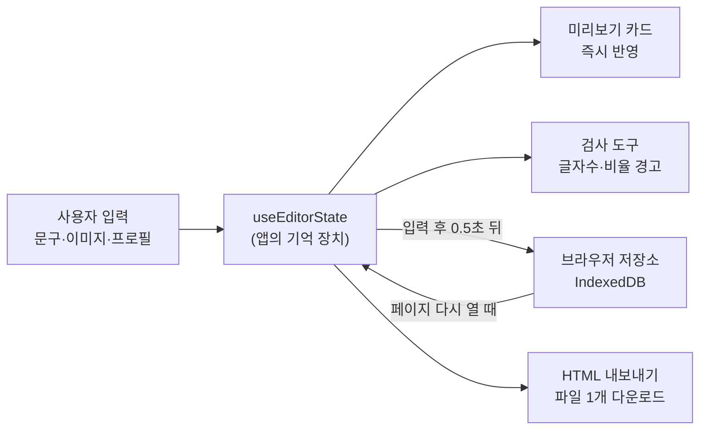

# 콘텐츠 발행 미리보기 – 구현 계획서 v1

> 작성일: 2026-10-28 · 작성자: 아론 · 대상: 제이슨 및 기획/디자인/마케팅 담당자

---

## 1. 한 줄 요약

**문구와 이미지를 올리면, 인스타그램 피드와 유튜브 커뮤니티 게시물이 실제 앱에서 어떻게 보일지 바로 확인하고, 그 결과를 `HTML 파일 1개`로 내려받아 메신저로 공유할 수 있는 웹페이지**를 만듭니다.

- 로그인 없음 · 서버/DB 없음 (모든 처리는 사용자 브라우저 안에서 진행)
- 배포: Vercel (정적 사이트)

---

## 2. 참고 자료 분석 (docs 폴더)

| 자료 | 확인 내용 |
|---|---|
| `AI수학프리즘_발행미리보기.html` | 완성본 예시. 인스타/유튜브 카드 2개를 나란히 배치, 캐러셀(화살표·스와이프·점), 인스타 '더 보기' 접기, 유튜브 '자세히 보기', 글자수 표시, 라이트/다크 전환 |
| `IG-1 ~ IG-5` | 인스타 이미지 5장, **4:5 비율 (1080×1350)** |
| `YT-1 ~ YT-6` | 유튜브 이미지 6장, **1:1 비율 (1080×1080)** |

👉 이 샘플 HTML의 **카드 디자인과 동작을 그대로 재현**하되, 문구·이미지·프로필을 사용자가 직접 넣을 수 있게 만드는 것이 핵심입니다. 샘플 문구와 이미지는 **"샘플 불러오기" 버튼**으로 제공합니다.

---

## 3. 기능 목록

### 3.1 입력(편집) 기능
| # | 기능 | 설명 |
|---|---|---|
| F1 | 프로필 설정 | 계정 이름, 프로필 이미지 업로드 (미입력 시 이름 앞 글자로 동그란 아바타 자동 생성) |
| F2 | 문구 입력 | 인스타 캡션 / 유튜브 본문을 각각 입력. "인스타 문구를 유튜브로 복사" 버튼 제공 |
| F3 | 이미지 업로드 | 플랫폼별로 여러 장 업로드 (클릭 또는 끌어다 놓기) |
| F4 | 이미지 순서 변경 | 썸네일을 **드래그해서 순서 변경**, 개별 삭제 |
| F5 | 샘플 불러오기 | docs의 샘플 문구·이미지로 한 번에 채우기 |
| F6 | 전체 초기화 | 입력 내용 모두 지우기 (확인 창 표시) |

### 3.2 미리보기 기능
| # | 기능 | 설명 |
|---|---|---|
| P1 | 인스타 피드 카드 | 프로필, 캐러셀(n/전체 표시, 점 표시), 좋아요/댓글/공유/저장 아이콘, 캡션 첫 줄 + **더 보기** 접기, 해시태그 파란색 |
| P2 | 유튜브 커뮤니티 카드 | 프로필, 본문 + **자세히 보기/간략히**, 링크 파란색, 캐러셀, 좋아요/싫어요/댓글/공유 바 |
| P3 | 캐러셀 조작 | 좌우 화살표, 모바일 스와이프 |
| P4 | 실시간 반영 | 입력하는 즉시 미리보기에 반영 |

### 3.3 검증(경고) 기능
| # | 항목 | 인스타그램 | 유튜브 커뮤니티 |
|---|---|---|---|
| V1 | 글자 수 | 2,200자 | 5,000자 |
| V2 | 해시태그 수 | 30개 | – |
| V3 | 이미지 장수 | 최대 20장 | 최대 10장 |
| V4 | 이미지 비율 | 4:5 권장 (1:1도 허용, 그 외 경고) | 1:1 권장 (그 외 경고) |

- 기준 초과 시 노란색(주의)/빨간색(초과) 배지로 표시합니다. **업로드를 막지는 않고 알려주기만** 합니다.
- 기준값은 한 파일(`platformRules.js`)에 모아 두어, 플랫폼 정책이 바뀌면 숫자만 고치면 됩니다.

### 3.4 편의 기능
| # | 기능 | 설명 |
|---|---|---|
| C1 | 자동 저장 | 작성 중인 문구·이미지·프로필을 브라우저에 자동 저장 → 새로고침/재접속해도 유지 |
| C2 | 라이트/다크 모드 | 버튼으로 전환, 선택값 기억 |
| C3 | HTML 내보내기 | 현재 미리보기를 **샘플과 같은 형태의 단일 HTML 파일**로 다운로드 (이미지 포함, 인터넷 없이도 열림) |

> [!NOTE]
> 자동 저장은 이미지 용량이 커서 일반 저장소(localStorage, 약 5MB 제한) 대신 **브라우저 내장 DB(IndexedDB)** 를 사용합니다. 사용자의 PC에만 저장되며 외부로 전송되지 않습니다.

---

## 4. 화면 구조

### 4.1 데스크톱 (가로 1024px 이상)

```
┌──────────────────────────────────────────────────────────────┐
│ 헤더: 로고/제목     [샘플 불러오기] [초기화] [🌙테마] [⬇HTML 내보내기] │
├──────────────────────┬───────────────────────────────────────┤
│ ① 편집 패널 (왼쪽)    │ ② 미리보기 영역 (오른쪽)                  │
│                      │                                       │
│ [프로필]              │  ┌─ INSTAGRAM ─┐   ┌─ YOUTUBE ──┐      │
│  이름 / 프로필 이미지   │  │  카드        │   │  카드       │      │
│                      │  │  (캐러셀)    │   │  (본문)     │      │
│ [탭: 인스타 | 유튜브]  │  │  (캡션)      │   │  (캐러셀)   │      │
│  문구 입력창           │  └─────────────┘   └────────────┘      │
│  글자수·해시태그 배지   │   캡션 812/2,200자   본문 640/5,000자    │
│  이미지 업로드 영역     │                                       │
│  썸네일 (드래그 정렬)   │                                       │
│  비율 경고 표시         │                                       │
└──────────────────────┴───────────────────────────────────────┘
```

- 편집 패널은 왼쪽에 고정되고 스크롤이 독립적으로 움직입니다.
- 미리보기는 두 카드를 나란히 보여주며, 화면이 좁으면 위아래로 쌓입니다.

### 4.2 모바일/태블릿 (1024px 미만)

```
┌────────────────────────┐
│ 헤더 (아이콘 버튼)         │
├────────────────────────┤
│ [편집] [미리보기] 전환 탭   │
├────────────────────────┤
│ 선택한 화면만 전체 표시     │
└────────────────────────┘
```

### 4.3 내보낸 HTML 파일

- 샘플 `AI수학프리즘_발행미리보기.html`과 동일한 구성 (편집 패널 없이 두 카드 + 글자수 정보 + 테마 전환)
- 제목은 파일 생성 시 입력받거나 기본값("발행 미리보기") 사용

---

## 5. 기술 선택

| 항목 | 선택 | 이유 |
|---|---|---|
| 프레임워크 | **Vite + React (JavaScript)** | 가장 빠르고 안정적인 세팅, Vercel 기본 지원, 컴포넌트/훅 분리에 적합 |
| 스타일 | 순수 CSS (CSS 변수로 테마 관리) | 샘플 디자인을 그대로 옮기기 쉬움, 추가 학습 불필요 |
| 드래그 정렬 | `@dnd-kit/sortable` | 마우스·터치 모두 안정적으로 지원 |
| 자동 저장 | `idb-keyval` | IndexedDB를 한 줄로 쓸 수 있는 초경량 라이브러리 |
| 폰트 | Pretendard (웹폰트) | 한글 가독성 우수, 실제 앱 느낌에 가까움 |
| 배포 | Vercel | GitHub 연결 후 자동 배포, 별도 설정 파일 불필요 |

> [!IMPORTANT]
> 서버와 DB를 사용하지 않으므로 **외부 API 호출이 없습니다.** 따라서 `api` 폴더는 만들지 않고, 브라우저 저장 기능은 `utils/storage.js`에서 담당합니다. 추후 공유 링크 기능(Supabase 등)을 추가할 경우 `src/api/` 폴더를 새로 추가합니다.

---

## 6. 폴더 구조 및 파일 구성

```
contents-preview/
├─ docs/                              # 문서 및 샘플 자료 (기존 파일 유지)
│  ├─ implementation_plan_v1.md       # 본 문서
│  ├─ AI수학프리즘_발행미리보기.html     # 기존 샘플
│  └─ IG-*.png, YT-*.png              # 기존 샘플 이미지
│
├─ public/
│  ├─ favicon.svg
│  └─ samples/                        # "샘플 불러오기"용 이미지 (docs 이미지 복사본)
│     ├─ ig-1.png ~ ig-5.png
│     └─ yt-1.png ~ yt-6.png
│
├─ src/
│  ├─ main.jsx                        # 앱 시작점
│  ├─ App.jsx                         # 전체 레이아웃 조립 (편집 패널 + 미리보기)
│  │
│  ├─ components/
│  │  ├─ layout/
│  │  │  ├─ Header.jsx                # 상단 헤더와 버튼 묶음
│  │  │  └─ MobileTabs.jsx            # 모바일 편집/미리보기 전환 탭
│  │  ├─ editor/
│  │  │  ├─ EditorPanel.jsx           # 편집 패널 전체 틀 (플랫폼 탭 포함)
│  │  │  ├─ ProfileForm.jsx           # 계정 이름·프로필 이미지 입력
│  │  │  ├─ TextEditor.jsx            # 문구 입력창
│  │  │  ├─ ImageUploader.jsx         # 이미지 업로드 영역 (클릭/드롭)
│  │  │  └─ SortableImageList.jsx     # 썸네일 드래그 정렬·삭제
│  │  ├─ preview/
│  │  │  ├─ PreviewPanel.jsx          # 두 카드 배치
│  │  │  ├─ InstagramPost.jsx         # 인스타 피드 카드
│  │  │  ├─ YoutubePost.jsx           # 유튜브 커뮤니티 카드
│  │  │  ├─ Carousel.jsx              # 이미지 캐러셀 (공통)
│  │  │  ├─ CollapsibleText.jsx       # 더 보기/접기 텍스트 (공통)
│  │  │  └─ Avatar.jsx                # 프로필 동그라미 (공통)
│  │  └─ common/
│  │     ├─ Button.jsx                # 공통 버튼
│  │     ├─ LimitBadge.jsx            # 글자수/해시태그/장수 경고 배지
│  │     └─ ConfirmDialog.jsx         # 초기화 확인 창
│  │
│  ├─ hooks/
│  │  ├─ useEditorState.js            # 프로필·문구·이미지 상태 관리 + 자동 저장 연결
│  │  ├─ useCarousel.js               # 캐러셀 현재 위치·스와이프 처리
│  │  └─ useTheme.js                  # 라이트/다크 모드 상태와 저장
│  │
│  ├─ utils/
│  │  ├─ textFormat.js                # HTML 이스케이프, 해시태그·링크 색칠
│  │  ├─ validators.js                # 글자수·해시태그·장수·비율 검사
│  │  ├─ imageUtils.js                # 파일 → 이미지 데이터 변환, 비율 측정
│  │  ├─ storage.js                   # IndexedDB 저장/불러오기/삭제
│  │  ├─ sampleLoader.js              # 샘플 문구·이미지 불러오기
│  │  └─ exportHtml.js                # 단일 HTML 파일 생성·다운로드
│  │
│  ├─ constants/
│  │  ├─ platformRules.js             # 플랫폼별 제한값 (2,200자, 30개, 비율 등)
│  │  └─ sampleTexts.js               # 샘플 인스타 캡션·유튜브 본문
│  │
│  └─ styles/
│     ├─ tokens.css                   # 색상·폰트·간격 등 디자인 기준값, 다크 모드
│     ├─ app.css                      # 앱 레이아웃 (헤더, 편집 패널, 반응형)
│     └─ preview.css                  # 인스타/유튜브 카드 스타일 (내보내기에도 재사용)
│
├─ index.html                         # 제목·설명(SEO) 포함 기본 HTML
├─ package.json
├─ vite.config.js
└─ .gitignore
```

---

## 7. 데이터 흐름 (쉽게 설명)



- 이미지는 서버로 올라가지 않고, 브라우저 안에서 데이터로 변환되어 보관됩니다.
- 내보내기 시 이미지가 HTML 파일 안에 함께 들어가므로, 받는 사람은 **파일만 열면 바로 확인**할 수 있습니다.

---

## 8. 개발 단계 (Phase)

각 단계가 끝나면 아론이 먼저 테스트하고, 이상이 없으면 제이슨에게 테스트를 요청합니다. **테스트 완료 후 다음 단계로 진행**합니다.

### Phase 1 – 기본 세팅 + 미리보기 카드
- Vite + React 프로젝트 생성, 폴더 구조 세팅
- 디자인 토큰(tokens.css), 라이트/다크 모드
- 인스타/유튜브 카드, 캐러셀, 더 보기 접기 구현
- 샘플 데이터로 화면 표시
- ✅ **확인 포인트**: 샘플 HTML과 같은 모습·동작인지

### Phase 2 – 편집 기능
- 프로필 입력, 문구 입력, 이미지 업로드
- 이미지 드래그 정렬·삭제
- 샘플 불러오기, 전체 초기화
- 글자수·해시태그·장수·비율 경고 배지
- 데스크톱/모바일 반응형 레이아웃
- ✅ **확인 포인트**: 입력 즉시 미리보기 반영, 경고 정상 표시

### Phase 3 – 자동 저장 + HTML 내보내기
- IndexedDB 자동 저장/복원
- 단일 HTML 파일 내보내기
- ✅ **확인 포인트**: 새로고침 후 유지, 내보낸 파일이 다른 PC/모바일에서 정상 열림

### Phase 4 – 배포
- GitHub 저장소 연결 → Vercel 배포 (제이슨이 직접 진행, 아론이 단계별 안내)
- 배포 주소에서 최종 점검
- ✅ **확인 포인트**: 배포 주소에서 전체 기능 동작

---

## 9. 고려 사항 및 제약

> [!WARNING]
> **내보낸 HTML 파일 용량**: 원본 이미지가 그대로 들어가므로, 표지처럼 큰 PNG(약 1.7MB)가 여러 장이면 파일이 10MB 이상이 될 수 있습니다. 일부 메신저는 용량 제한이 있으므로, 내보내기 시 **"용량 줄이기(이미지 압축)" 옵션**을 함께 제공할 예정입니다.

- 실제 앱의 줄바꿈·'더 보기' 위치는 기기마다 조금 다를 수 있어, 미리보기 하단에 안내 문구를 표시합니다.
- 자동 저장 데이터는 **해당 브라우저에만** 남습니다. 다른 PC에서 이어서 작업하려면 HTML 내보내기를 이용해야 합니다.
- 플랫폼 제한값(글자수 등)은 2026년 10월 기준이며, 변경 시 `platformRules.js`만 수정합니다.

---

## 10. 확인이 필요한 사항

1. **화면 디자인 톤**: 편집 화면은 깔끔한 업무용 툴 느낌(밝은 기본 + 다크 지원)으로 계획했습니다. 원하시는 톤이 있으면 알려주세요.
2. **유튜브 문구 기본 펼침 여부**: 샘플은 유튜브 본문이 처음부터 펼쳐져 있습니다. 실제 앱처럼 접힌 상태로 시작할지 정해주세요. (계획: 샘플과 동일하게 펼침)
3. **HTML 내보내기 제목**: 내보낼 때마다 제목을 입력받을지, 기본값을 쓸지 정해주세요. (계획: 입력창 제공, 비우면 기본값)
